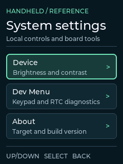
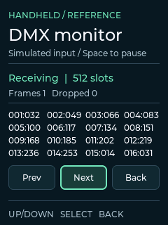
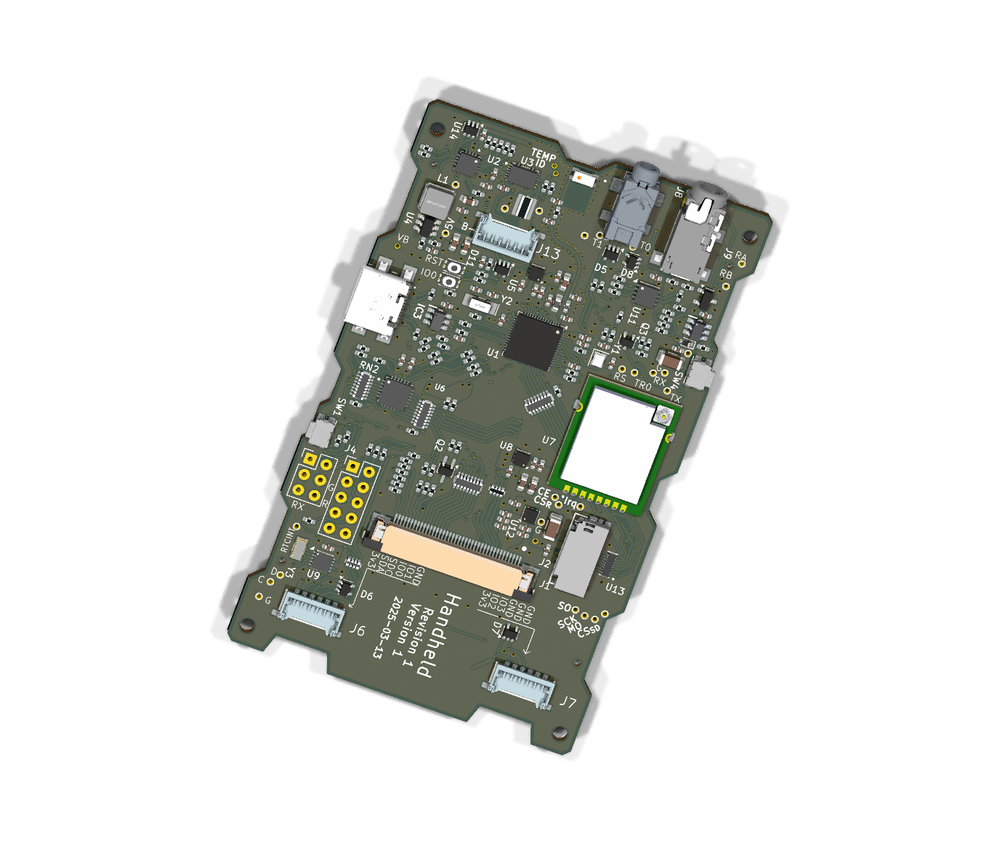

# Handheld Reference

An ESP32-S3 handheld with a physical keypad, a 240 × 320 display, and an RS-485 port for monitoring DMX512. Explore the same LVGL interface on the device or in the SDL2 simulator, then use the firmware as a starting point for your own peripherals and screens.

<p align="center">
  
</p>

[Run the simulator](#run-it-on-a-desktop) · [Build on the firmware](#build-on-this-firmware) · [Explore the hardware](#hardware-and-enclosure)

## Explore the interface

<p>
  
  
  
  
</p>

*Screens captured from the SDL2 simulator. The simulator supplies a sample clock and synthetic DMX traffic.*

The demo includes persistent display settings, keypad and RTC diagnostics, and a receive-only DMX monitor that displays frame counts and up to 512 slot values.

## Run it on a desktop

Install CMake, a C compiler, and SDL2 2.0.18 or later. The simulator uses LVGL 8.3.11. Use the commands below to fetch it, or point CMake at the copy fetched by the firmware build.

```sh
git clone --depth 1 --branch v8.3.11 https://github.com/lvgl/lvgl.git ../lvgl-8.3.11
cmake -S simulator -B simulator/build -DLVGL_DIR=../lvgl-8.3.11
cmake --build simulator/build --parallel
./simulator/build/handheld-sim
```

Use **↑ / ↓**, **Enter**, and **Esc**, or click a row. The simulator uses a sample clock and keeps display settings for the current session. Open **Dev Menu → DMX monitor** to inspect a synthetic signal. Press **Space** on that page to pause or resume the input.

## Build the firmware

With the ESP-IDF **5.3.1** environment active:

```sh
./scripts/build.sh build
```

The target is the rev 2 handheld board. See [build and verification](docs/build-and-verification.md) for the pinout, the headless simulator check, and the flash layout before trying the image on hardware.

## Build on this firmware

| To do this | Start here |
| --- | --- |
| See how board drivers, feature logic, and the UI fit together | [Firmware architecture](docs/firmware-architecture.md) |
| Add a peripheral and show its data | [Add an I²C temperature sensor](docs/add-i2c-sensor.md) |
| Expose a feature to the GUI and simulate it | [System feature interface](docs/system-features.md) |
| Add a keypad and desktop screen | [Extend the GUI](docs/extend-gui.md) |
| Work on continuous serial input | [DMX over RS‑485](docs/dmx-rs485.md) |
| Verify an extension in the simulator and on the bench | [Build and verification](docs/build-and-verification.md) |

## Hardware and enclosure

<p>
  <a href="assets/pcb/main-board-back.png"></a>
  <a href="assets/pcb/keypad-front.png"></a>
</p>

*KiCad renders of the main board and keypad.*

The [hardware reference](docs/build-and-verification.md#schematics-and-pcb-renders) includes schematic PDFs and PCB renders for the main board, keypad, and optional DMX prefilter. The [enclosure guide](enclosure/README.md) links to the FreeCAD solids, STEP model, and individual STL files.

## License

The firmware and tools use [PolyForm Noncommercial 1.0.0](https://polyformproject.org/licenses/noncommercial/1.0.0). The enclosure, hardware drawings and renders, and documentation use [CC BY-NC-SA 4.0](https://creativecommons.org/licenses/by-nc-sa/4.0/). See [LICENSE](LICENSE) for scope and attribution.
