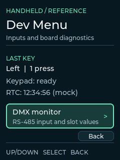
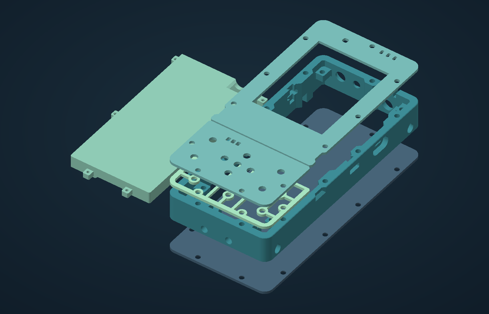

# Handheld Reference

A keypad-driven ESP32-S3 handheld with a 240 × 320 display, local settings, a DMX512 monitor over RS‑485, and a printable enclosure. The same LVGL interface runs on the board and in an SDL2 simulator, so you can explore it without hardware.

<p>
  
  
  
  
</p>

- **Device** controls the backlight and high contrast. The firmware stores the settings in NVS.
- **Dev Menu** reports the last key, a press count, keypad availability, and the real-time clock.
- **DMX monitor** shows all received slot values in banks of 16, with signal status and drop counts.
- **About** shows the build target and firmware version.
- **Enclosure** includes a FreeCAD model, neutral STEP solids, and individual STL exports.

This is the standalone reference edition of a working handheld project. Its focus is the display, physical input, serial diagnostics, and mechanical packaging. The original application, radio protocol, and animation playback are outside this edition.

## Run it on a desktop

Install CMake, a C compiler, SDL2 2.0.18 or later, and LVGL 8.3.11. A firmware build fetches LVGL automatically. For a simulator-only setup, point CMake at a separate LVGL 8.3.11 checkout:

```sh
git clone --depth 1 --branch v8.3.11 https://github.com/lvgl/lvgl.git ../lvgl-8.3.11
cmake -S simulator -B simulator/build -DLVGL_DIR=../lvgl-8.3.11
cmake --build simulator/build --parallel
./simulator/build/handheld-sim
```

Use **↑ / ↓**, **Enter**, and **Esc**, or click a row. The simulator uses a sample clock and keeps display settings for the current session. Open **Dev Menu → DMX monitor** to inspect a synthetic signal. Press **Space** on that page to pause or resume the input.

## Build the firmware

With the ESP-IDF **5.3.1** environment active:

```sh
./scripts/build.sh build
```

The target is the rev 2 handheld board. See [build and verification](docs/build-and-verification.md) for the pinout, the headless simulator check, and the flash layout before trying the image on hardware.

## Explore the design



| Topic | Start here |
| --- | --- |
| Display DMA, keyboard input, and persistent settings | [Firmware architecture](docs/firmware-architecture.md) |
| UART buffering, DMX framing, and bench verification | [DMX over RS‑485](docs/dmx-rs485.md) |
| What the simulator exercises and what still needs hardware | [Build and verification](docs/build-and-verification.md) |
| CAD formats, part selection, and fit checks | [Enclosure guide](enclosure/README.md) |

## License

Firmware and tools: [PolyForm Noncommercial 1.0.0](https://polyformproject.org/licenses/noncommercial/1.0.0). Enclosure and documentation: [CC BY-NC-SA 4.0](https://creativecommons.org/licenses/by-nc-sa/4.0/). See [LICENSE](LICENSE) for scope and attribution.
