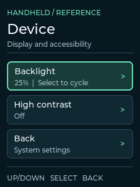
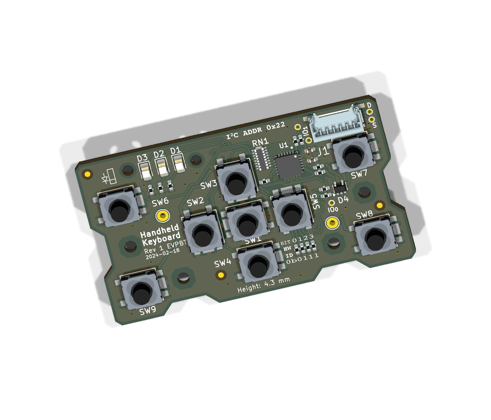

# Handheld Reference

A keypad-driven ESP32-S3 handheld with a 240 × 320 display, local settings, a DMX512 monitor over RS‑485, and a printable enclosure. Use it as a starting point for a new peripheral, diagnostic tool, or handheld interface. The same LVGL interface runs on the board and in an SDL2 simulator, so you can develop screens and exercise failure states without hardware.

<p>
  
  
  
  
</p>

The demo includes persistent display settings, keypad and RTC diagnostics, and a receive-only DMX monitor. The [firmware architecture](docs/firmware-architecture.md) explains how board drivers, system features, and the shared UI fit together.

## Build on this firmware

| I want to… | Start here |
| --- | --- |
| Understand where my change belongs | [Firmware architecture](docs/firmware-architecture.md) |
| Add a peripheral and show its data | [Add an I²C temperature sensor](docs/add-i2c-sensor.md) |
| Expose a feature to the GUI and simulate it | [System feature interface](docs/system-features.md) |
| Add a screen that works on the keypad and desktop | [Extend the GUI](docs/extend-gui.md) |
| Work on continuous serial input | [DMX over RS‑485](docs/dmx-rs485.md) |
| Trace firmware signals on the board | [Schematics and PCB renders](docs/build-and-verification.md#schematics-and-pcb-renders) |
| Build and verify an extension | [Build and verification](docs/build-and-verification.md) |

## Run it on a desktop

Install CMake, a C compiler, SDL2 2.0.18 or later, and LVGL 8.3.11. A firmware build fetches LVGL automatically. For a simulator-only setup, point CMake at a separate LVGL 8.3.11 checkout:

```sh
git clone --depth 1 --branch v8.3.11 https://github.com/lvgl/lvgl.git ../lvgl-8.3.11
cmake -S simulator -B simulator/build -DLVGL_DIR=../lvgl-8.3.11
cmake --build simulator/build --parallel
./simulator/build/handheld-sim
```

Use **↑ / ↓**, **Enter**, and **Esc**, or click a row. The simulator uses a sample clock and keeps display settings for the current session. Open **Dev Menu → DMX monitor** to inspect a synthetic signal. Press **Space** on that page to pause or resume the input.

## Build the firmware

With the ESP-IDF **5.3.1** environment active:

```sh
./scripts/build.sh build
```

The target is the rev 2 handheld board. See [build and verification](docs/build-and-verification.md) for the pinout, the headless simulator check, and the flash layout before trying the image on hardware.

## Hardware and enclosure

The [hardware reference](docs/build-and-verification.md#schematics-and-pcb-renders) includes vector schematic PDFs and PCB renders for the main board, keypad, and optional DMX prefilter.

<p>
  
  
</p>

The [enclosure guide](enclosure/README.md) links to the FreeCAD solids, STEP model, and individual STL files. It also describes which parts to print first and what to check for fit.


## License

The firmware and tools use [PolyForm Noncommercial 1.0.0](https://polyformproject.org/licenses/noncommercial/1.0.0). The enclosure, hardware drawings and renders, and documentation use [CC BY-NC-SA 4.0](https://creativecommons.org/licenses/by-nc-sa/4.0/). See [LICENSE](LICENSE) for scope and attribution.
