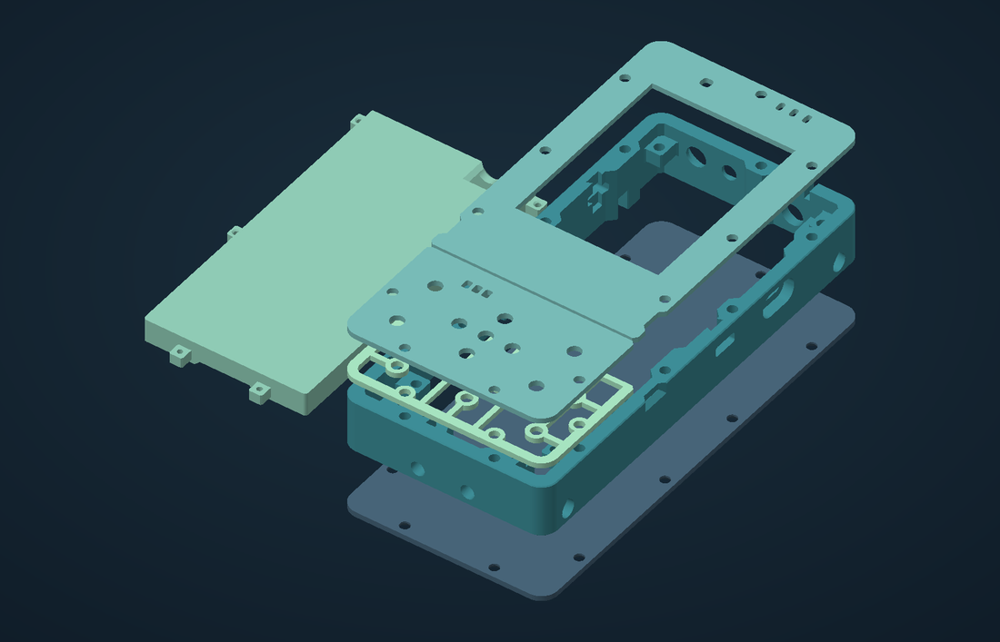

# Handheld enclosure

The enclosure packages a 240 × 320 LCD above a separate keypad, with a removable rear cover, battery cradle, and small light pipes and actuators. The chassis is approximately 62.4 × 133.3 mm before protruding parts.

| File | Use it for |
| --- | --- |
| [handheld-enclosure.FCStd](handheld-enclosure.FCStd) | Inspect or modify the neutral solids in FreeCAD |
| [handheld-enclosure.step](handheld-enclosure.step) | Import the solids into another CAD tool |
| [print/](print/) | Slice individual parts, in millimeters |

The FreeCAD document contains separate editable solids without the original feature history. The STEP file preserves solid geometry. The STL files use CAD coordinates, so drop each mesh to the build plate and choose orientation in your slicer. The model is a parts collection; it has no assembly constraints.

## Parts and fit

- Start with the chassis, display bezel, keypad bezel, and plain rear cover. Check the display opening, screw holes, and keypad travel with your actual parts.
- The battery cradle and connector retainer are separate. The retainer uses an earlier valid shape without the final decorative chamfer.
- The keypad aligner, light pipes, and power/reset actuators and caps are separate exports. Print small fit samples before committing to the complete case.

The earlier prototype had light bleed around the display light pipes, short side-button actuators, and a tight battery-cradle fit. This export has been checked as CAD geometry. Print clearances, materials, and the fit of this edition still need a physical check. PCB files and third-party component models are outside the enclosure release.
